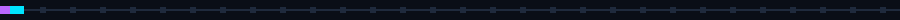
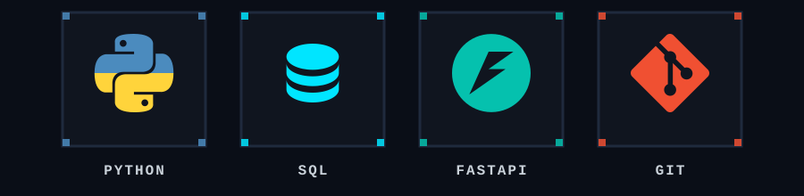

<div align="center">



</div>

<div align="center">

</div>

<div align="center">

</div>

<div align="center">

</div>

## Inventory

<div align="center">

</div>

<div align="center">

</div>

## Player Stats

<div align="center">
<table>
<tr>
<td width="50%" align="center">

</td>
<td width="50%" align="center">

</td>
</tr>
</table>
</div>

## Quest Log

<div align="center">

<br>

</div>

<div align="center">

</div>

## Connect Player 2

<div align="center">

<a href="https://www.linkedin.com/in/ashish-sharma-751551268/"></a>
<a href="mailto:ashish.sharma.engineering@gmail.com"></a>
<a href="https://leetcode.com/u/CodeWithAshish/"></a>

</div>

<div align="center">

</div>

```bash
$ git commit -m "think, build, repeat"
[main] GAME SAVED. See you in the next commit.
```
